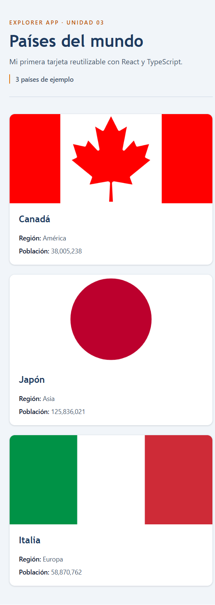

# Explorer App React

Esta es mi primera migración de Explorer App a React. La tarjeta recibe un país por props y se reutiliza con tres datos locales.

## Tecnologías

- React 18 y React DOM 18
- Vite y TypeScript
- Tailwind CSS v4
- pnpm

## Requisitos y comandos

Se recomienda Node.js 22.12 o posterior dentro de la versión 22, además de pnpm.

```sh
pnpm install
pnpm dev
```

Para comprobar la compilación:

```sh
pnpm build
```

## Captura



## Componentes y datos

- `src/App.tsx` usa el mismo componente para Canadá, Japón e Italia.
- `src/components/CountryCard.tsx` recibe `country: Country` mediante `CountryCardProps` y muestra nombre, bandera, región y población.
- `src/types/country.ts` conserva el contrato de país de la versión Vanilla TypeScript.
- `src/utils/format.ts` conserva `formatPopulation`, que agrupa la población usando la configuración regional `es-SV`.
- `src/data/countries-demo.ts` guarda los tres ejemplos con el tipo `Country`.

## Lo que aprendí

1. Antes la tarjeta generaba HTML y se insertaba manualmente en el DOM. Ahora `CountryCard` devuelve JSX y React la representa.
2. El componente recibe un objeto `country`, tipado como `Country` en su interfaz de props.
3. Reutilicé el tipo `Country` y `formatPopulation` de Vanilla TypeScript para mantener la forma de los datos y no repetir el formato de población.
4. Comprobé que el mismo componente muestra datos distintos para tres países. La búsqueda reactiva y la carga con fetch quedan para las siguientes sesiones.
