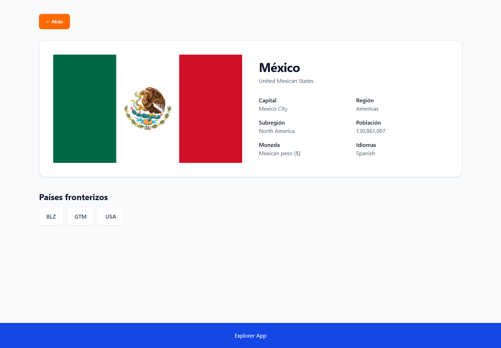
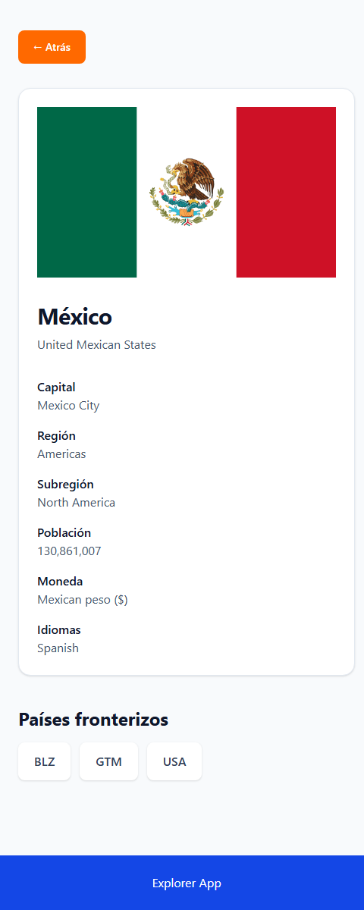

# Explorer App

Aplicación de exploración de países desarrollada con React y TypeScript. Permite buscar países, filtrar por región y consultar su información en una ruta de detalle, sin recargar la página.

- **Repositorio:** [Diseño web adaptable](https://github.com/josehrdez127-hue/Dise-o-web-adaptable/tree/s25-atomic-design)
- **Aplicación en Vercel:** pendiente de publicación y autenticación de la cuenta.

## Tecnologías

- React 18 y React DOM 18
- TypeScript 7 y Vite 8
- React Router DOM 6
- Tailwind CSS 4
- lucide-react
- pnpm

## Requisitos y ejecución

Se requiere Node.js 22.12 o posterior de la rama 22 y pnpm.

```sh
git clone --branch s25-atomic-design --single-branch https://github.com/josehrdez127-hue/Dise-o-web-adaptable.git explorer-react
cd explorer-react
pnpm install
pnpm dev
```

Vite muestra la dirección local en la terminal. Comandos adicionales:

```sh
pnpm build    # comprueba los tipos y genera dist/
pnpm lint     # ejecuta oxlint
pnpm preview  # sirve localmente la compilación de producción
```

## Funcionalidades

- Listado de países con bandera, región, capital y población.
- Búsqueda controlada por nombre y filtro por región, combinables y limpiables.
- Estados de carga, error y resultados vacíos.
- Navegación SPA desde una tarjeta a `/country/:code`, con detalle consultado a partir del código de la URL.
- Detalle adaptable con capital, región, población, moneda, idiomas y países fronterizos.
- Enlaces a países fronterizos y retorno al listado.
- Rutas desconocidas que vuelven a la página de inicio.

## Capturas

### Listado de países


### Detalle en escritorio



### Detalle en móvil



## Organización

- `src/main.tsx` monta React y configura `BrowserRouter`.
- `src/App.tsx` define las rutas `/`, `/country/:code` y la ruta comodín.
- `src/pages/HomePage.tsx` compone el listado y conecta los controles con los hooks.
- `src/pages/CountryDetailPage.tsx` resuelve el parámetro con `useParams` y presenta el detalle.
- `src/components/` contiene los controles, tarjetas, encabezado y cuadrícula.
- `src/hooks/useCountries.ts` gestiona carga, error y cancelación de la petición de listado.
- `src/hooks/useSearch.ts` administra la consulta, la región y el filtrado combinado.
- `src/hooks/useCountryDetail.ts` consulta el detalle por código, descarta solicitudes obsoletas y permite reintentar.
- `src/services/countries.ts` obtiene, valida y adapta los datos.
- `src/types/`, `src/data/` y `src/utils/` contienen los contratos TypeScript, la relación de códigos fronterizos y los formatos reutilizables.

## Datos

El servicio obtiene los países desde [mledoze/countries](https://github.com/mledoze/countries) y las cifras de población desde la API del [Banco Mundial](https://api.worldbank.org/). Las respuestas se validan y adaptan a los tipos de la aplicación. La fuente `public/data/countries.json` de la guía no existe en este repositorio.

## Migración de Vanilla TypeScript a React

- Se reutilizaron el contrato `Country` y la utilidad `formatPopulation` de la versión Vanilla.
- La tarjeta que antes generaba e insertaba HTML se adaptó a un componente JSX con props tipadas; la cuadrícula se compone con componentes React.
- La carga externa se implementó en el servicio actual: consulta dos fuentes públicas, valida sus respuestas y adapta el resultado. No se reutilizó una API local `countries.json`.
- La navegación manual basada en hash se sustituyó por `BrowserRouter`, rutas declarativas, `useNavigate`, `Link` y `useParams`.
- La carga, la búsqueda y el detalle se separaron en custom hooks; extraerlos no comparte automáticamente el estado entre páginas.

## Lista de verificación del cierre

Comprobaciones realizadas el **22 de noviembre de 2026** en local, salvo donde se indica:

| Comprobación | Resultado | Evidencia u observación |
|---|---|---|
| Listado | Cumple | Se cargaron 250 países con sus tarjetas y banderas. Captura en la sección anterior. |
| Búsqueda | Cumple | «Canadá» devuelve una tarjeta; al limpiar, regresa el listado. |
| Filtro por región | Cumple | «América» devuelve 56 países en la prueba local. |
| Búsqueda y región combinadas | Cumple | «Canadá» + «América» devuelve una tarjeta. |
| Estado vacío | Cumple | Una búsqueda sin coincidencias presenta un mensaje de resultados vacíos. |
| Carga y error de listado | Implementados | `useCountries` expone ambos estados; el componente muestra carga y anuncia el error. |
| Detalle y parámetro de ruta | Cumple | `/country/CA` muestra Canadá. |
| Recarga de URL directa | Cumple en local | Se recargó `/country/CA` y el detalle volvió a mostrarse. El alojamiento aún debe validarse. |
| País no válido | Cumple | `/country/ZZ` muestra un mensaje comprensible y la acción «Reintentar». |
| Fronteras | Cumple | Se verificó México → `GTM` → Guatemala en `/country/GT`. |
| Diseño adaptable | Cumple en la prueba local | El detalle no tuvo desbordamiento horizontal en un viewport móvil de 375 px. Hay capturas móvil y escritorio. |
| Build y lint | Cumple | `pnpm build` y `pnpm lint` finalizaron correctamente. |
| Modo oscuro y debounce | No implementados | Eran comprobaciones condicionales («si ya estaba implementado» / «si ya forma parte»). |

El estado de carga se observa durante las solicitudes; no se incluye una captura separada de ese instante. Las solicitudes de datos dependen de servicios públicos externos.

## Publicación y medición inicial

- **URL de Vercel:** pendiente. El entorno de trabajo no tiene una sesión de Vercel autenticada.
- **Lighthouse:** pendiente hasta contar con la URL publicada. Registrar Performance, Accessibility y Best Practices, junto con la fecha, la URL, el modo móvil/escritorio y el informe o captura.
- La configuración de Vercel conserva las rutas SPA para que las URLs de detalle puedan recargarse directamente.
- **Pull Request:** no se utilizó en este cierre; los cambios se publicaron directamente en la rama `s25-atomic-design`.

## Refactor y pendientes

El refactor de este cierre memoriza en `useSearch` los resultados derivados: vuelve a filtrar solo si cambian los países, la consulta o la región. La búsqueda y el filtro conservan el mismo resultado observable, y los componentes visuales mantienen sus props tipadas.

Pendiente: publicar en Vercel, validar la recarga de rutas en producción, registrar Lighthouse y enlazar esas evidencias. La autoevaluación de la Unidad 3 debe responderla el estudiante en Canvas, según su propio proceso de aprendizaje.
