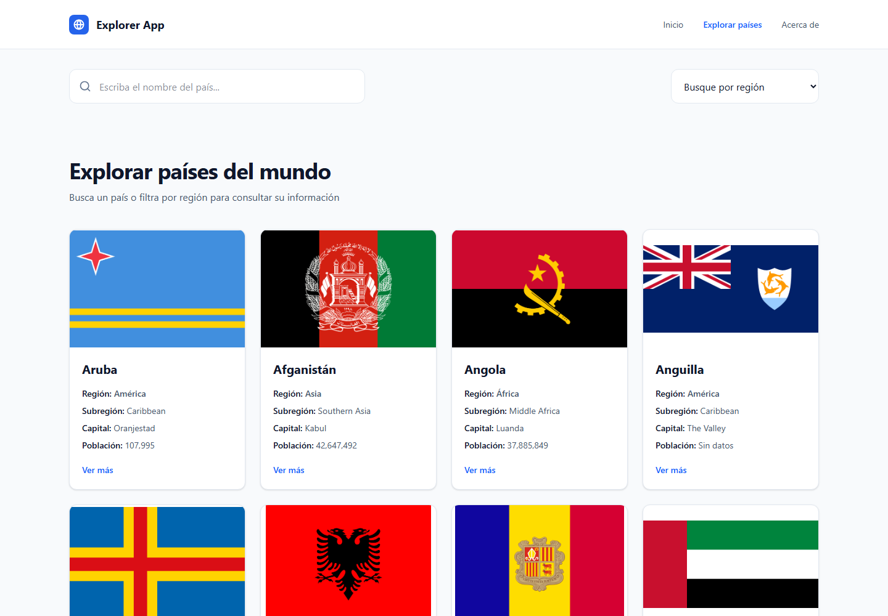
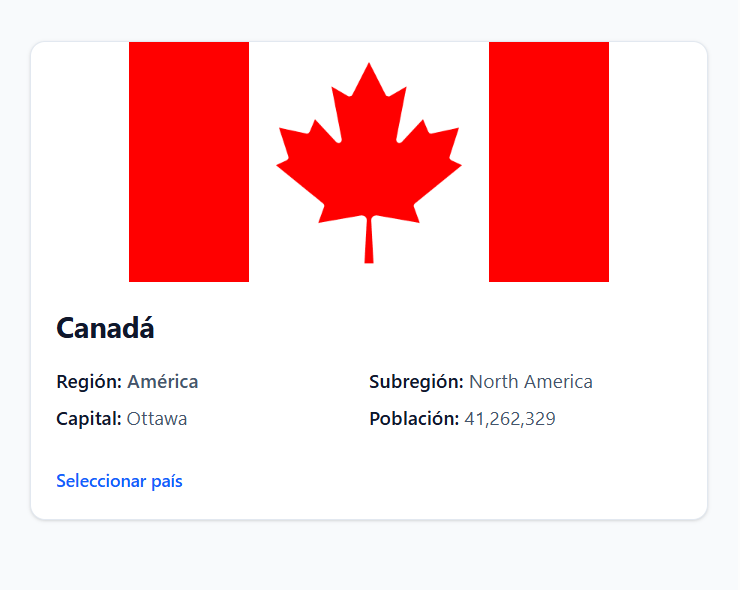

# Explorer App React

Esta es mi migración de Explorer App a React. Conservé el encabezado, la navegación, los filtros y el estilo claro con azul de Explorer 1. La tarjeta recibe un país por props y se reutiliza con datos cargados desde fuentes públicas.

## Tecnologías

- React 18 y React DOM 18
- Vite y TypeScript
- Tailwind CSS v4
- lucide-react para los iconos de búsqueda y navegación
- pnpm

## Cómo ejecutar el proyecto

Necesitas Node.js 22.12 o posterior dentro de la versión 22 y pnpm.

1. Clona la rama de entrega:

```sh
git clone --branch parcial-2 --single-branch https://github.com/josehrdez127-hue/Parcial-de-dise-o-web-adaptable.git ExplorerApp
cd ExplorerApp
```

2. Instala las dependencias:

```sh
pnpm install
```

3. Inicia el servidor de desarrollo:

```sh
pnpm dev
```

Vite mostrará en la terminal la dirección local para abrir la aplicación en el navegador. Para detener el servidor, pulsa `Ctrl+C`.

4. Para generar la versión de producción y comprobar los tipos:

```sh
pnpm build
```

El resultado de producción se genera en la carpeta `dist/`.

## Captura



## Componentes y datos

- `src/App.tsx` carga países al montar, muestra los estados de carga y error, conserva los filtros y entrega los resultados a `CountryGrid`.
- `src/services/countries.ts` consulta los datos de países de [mledoze/countries](https://github.com/mledoze/countries) y las poblaciones del [Banco Mundial](https://api.worldbank.org/), valida y adapta las respuestas al tipo `Country`, y acepta una señal para cancelar las solicitudes.
- `src/components/atoms/Badge.tsx` muestra la región y `src/components/atoms/Flag.tsx` muestra la bandera.
- `src/components/molecules/CountryCard.tsx` recibe `country: Country` y `onSelect`; combina `Flag` y `Badge`.
- `src/components/organisms/CountryGrid.tsx` recibe `countries: Country[]` y `onSelect`, crea una tarjeta por país con `map()` y una key basada en `cca2`, y adapta su cuadrícula de una a cuatro columnas según el ancho de pantalla.
- `src/components/molecules/SearchBar.tsx` y `src/components/molecules/RegionFilter.tsx` son controles controlados con props y callbacks tipados.
- `src/components/organisms/Header.tsx` recibe contenido mediante `children` y transmite el estado y los callbacks de filtros a sus controles.
- `src/App.tsx` mantiene `query` y `region`, combina ambos filtros localmente y entrega los países coincidentes a `CountryGrid`.
- `src/types/country.ts` conserva el contrato de país de la versión Vanilla TypeScript.
- `src/utils/format.ts` conserva `formatPopulation`, que agrupa la población usando la configuración regional `es-SV`.

La barra de búsqueda y el selector conservan la apariencia de Explorer 1 y funcionan como componentes controlados. La búsqueda por nombre y el filtro por región se aplican juntos; al limpiar la búsqueda o seleccionar la opción predeterminada de región, se actualizan los resultados inmediatamente. La consulta se ejecuta una vez al montar el componente y se cancela al desmontarlo; los cambios en los filtros no vuelven a solicitar los datos.

## Evidencia S29



- **Dependencias:** `useEffect` usa `[]` para cargar los datos al montar. La búsqueda y el filtro se aplican sobre los datos ya cargados, por lo que no generan solicitudes adicionales.
- **Limpieza:** `AbortController` cancela ambas solicitudes al desmontar el componente y se evita actualizar el estado tras la cancelación.
- **Estados:** se muestra “Cargando países...” durante la consulta; los resultados aparecen al completarse; si falla, se anuncia el error. Los países sin dato de población muestran “Sin datos”.

## Lo que aprendí

1. Antes la tarjeta generaba HTML y se insertaba manualmente en el DOM. Ahora `CountryCard` devuelve JSX y React la representa.
2. El componente recibe un objeto `country`, tipado como `Country` en su interfaz de props.
3. Reutilicé el tipo `Country` y `formatPopulation` de Vanilla TypeScript para mantener la forma de los datos y no repetir el formato de población.
4. Comprobé que `CountryGrid` recibe el arreglo y entrega cada país y la acción a una tarjeta. La key usa el código estable `cca2`.
5. `country` lleva los datos; `onSelect` lleva una función que se ejecuta al pulsar el botón. `Header` recibe su contenido como `children`.
6. La carga asíncrona sustituye los datos de demostración y muestra estados de carga y error sin recargar la página.
